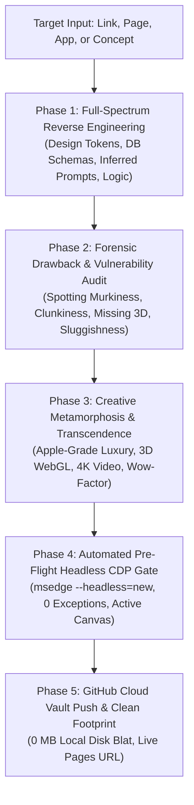

# Omni God Mode Engine (`god-mode`)

## ⚡ Executive Mandate
**Omni God Mode** is the ultimate frontier capability. Whenever the user provides **ANY link, webpage, UI screenshot, application, codebase, or product concept**, God Mode does NOT merely copy or summarize it. It executes full-spectrum reverse-engineering, ferrets out every flaw or limitation in the original, and engineers a transcendent, world-class product that elevates the concept to its absolute theoretical peak—backed by 100% automated headless verification.

---

## 🏛️ The 5 Pillars of Omni God Mode

---

### Phase 1: Full-Spectrum Reverse Engineering
When given any URL, webpage, or product:
1. **Visual & UI/UX Design Token Extraction**:
   - Exact/inferred color palette (primary, secondary, surfaces, hairlines, contrast ratios).
   - Optical typography scale (font pairings, snug display kerning, monospace micro-tags).
   - Layout & spatial grid (4px/8px cadences, flex/grid constraints, container bounds).
   - Motion & elevation (spring physics, drop shadows, glassmorphism blur tokens).
2. **Database & Architecture Reverse-Modeling**:
   - Model the exact underlying 3NF / NoSQL database schemas, foreign keys, and indexes.
   - Map API contracts, REST/GraphQL endpoints, WebSocket streaming channels, and auth lifecycles.
3. **Inferred System Prompts & Core Logic**:
   - Reverse-engineer the hidden prompt architecture, state machines, business invariants, and algorithms driving the application.

---

### Phase 2: Forensic Drawback & Defect Audit (What Is Lacking?)
Uncompromisingly audit the target for everything it does poorly:
* **Visual Murkiness**: Is the background a dull, gloomy black `#000000` void? (Banned).
* **Missing Dimensionality**: Is it relying on flat 2D clipart or static images where real 3D objects or video should be?
* **Missing Motion & Kinetic Soul**: Are transitions abrupt, robotic, or linear rather than organic 60/120fps springs?
* **UX Friction & Information Architecture**: Are layouts cluttered, confusing, or lacking clear visual hierarchies?
* **Performance & Reliability Bottlenecks**: Heavy bundle sizes, unoptimized queries, missing error boundaries.

---

### Phase 3: Transcendence & Creative Metamorphosis (Overcoming Drawbacks)
Rebuild the product, transcending the original benchmark through radical creativity:
1. **Luminous Luxury Environment (UI/UX Pro Max)**:
   - Provide crystal-clear architectural showroom lighting (Apple Luminary Gallery standard).
   - Multi-environment studio presets (Showroom, Golden Hour Sunset, Neon Carbon).
2. **True 3D WebGL & Real 4K Video Harmony**:
   - Real interactive 3D WebGL / Three.js model with physical PBR materials, clearcoat reflections, and mechanical opening parts (hoods, doors, modules).
   - High-definition real broadcast video loops / Apple Keynote scrollytelling canvas frame scrubbers.
3. **Signature 'Wow Factor' Breakthrough**:
   - Inject at least one unforgettable signature feature (e.g. zero-dependency procedural sound synthesizer, live 3D material configurator, tactile physics shaders, personalized serialized registry plaque).

---

### Phase 4: Mandatory Pre-Flight Headless Browser Verification Gate
* **The Zero-User-QA Invariant**:
  - Automatically run headless Edge/Chromium via Chrome DevTools Protocol (`msedge --headless=new --remote-debugging-port`).
  - Verify `Runtime.exceptionThrown === 0`.
  - Verify WebGL canvas dimensions $> 0$ and active frame render loop.
  - Verify all buttons, modals, audio synthesizers, and video players function without console warnings.
  - If any error is detected, autonomously repair it before the user ever sees it.

---

### Phase 5: GitHub Cloud Vault Deployment & Clean Disk Footprint
1. Initialize Git and set verified credentials (`adityanimbalkar9699-max`).
2. Push full source code, assets, documentation, and publication-grade PDF specification to GitHub.
3. Verify remote repository integrity on GitHub Pages.
4. Purge local working directory to achieve **0 MB local disk footprint**.
5. Output executive access receipt with live URL, repository link, and clone command.
