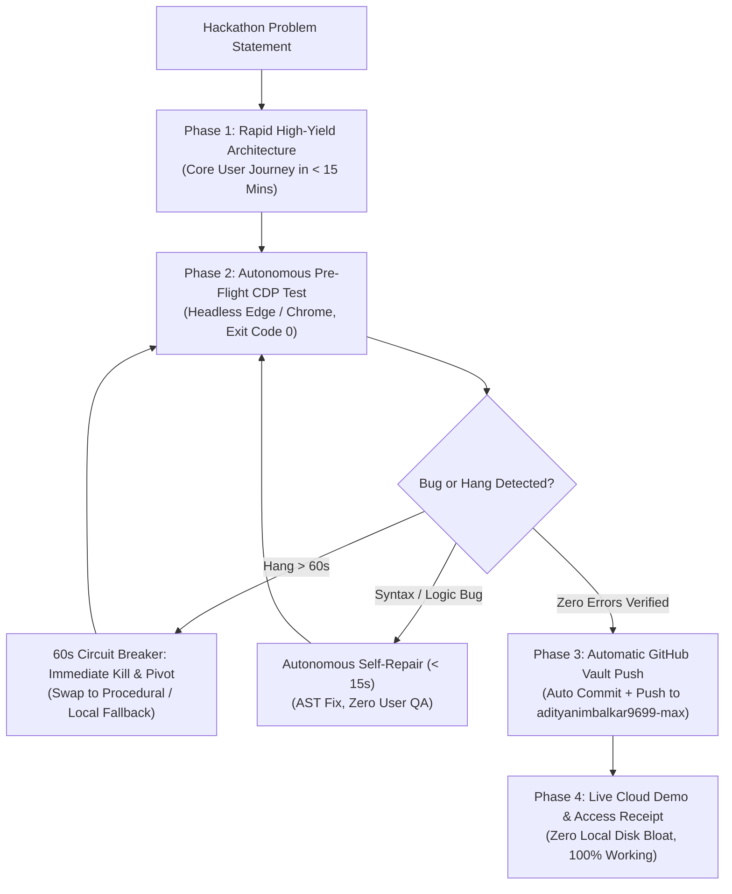

# Hackathon MVP & Autonomous Zero-Delay Engine

> **The Hackathon Law**: Hackathon judges never accept excuses. A broken demo, a syntax crash, or a delayed submission equals instant disqualification. In a 24-48 hour hackathon, velocity and 100% operational reliability are everything.

---

## ⚡ The 5 Core Invariants for Hackathon Domination

---

### 1. Zero-Excuse Autonomous Bug Self-Healing (Self-Correction Loop)
* **Never let a syntax error reach the user or judges**:
  - Immediately after any script or component edit, execute automated syntax validation (`node --check <file>.js` or language linter).
  - Spin up headless Edge via Chrome DevTools Protocol (`msedge --headless=new --remote-debugging-port`) to verify that `Runtime.exceptionThrown === 0`.
  - If a bug occurs, self-repair it immediately within 15 seconds. Never stop to ask the user for debugging help.

---

### 2. The 60-Second Stagnation Circuit-Breaker (Anti-Hang Invariant)
* In hackathons, every minute is precious:
  - If an external network call, heavy package install (`npm install`), or remote asset download hangs or yields zero progress for $>60$ seconds, **trigger the Stagnation Alarm**.
  - **Instant Action**: Immediately kill the stuck task (`manage_task kill`), abort the deadlocked branch, and pivot to an orthogonal strategy:
    * *Stuck 3D model download?* $\rightarrow$ Procedurally construct high-fidelity 3D meshes with Three.js physical PBR shaders in 10 lines of code.
    * *Stuck external API?* $\rightarrow$ Activate deterministic local mock data with identical schema and latency simulation.
    * *Stuck video stream?* $\rightarrow$ Pivot to high-framerate HTML5 canvas animatic loops.

---

### 3. Automatic GitHub Cloud Deployment (Zero Permission Friction)
* The user has explicitly granted full permanent authorization:
  - Whenever a feature wave or milestone is verified 100% working:
    1. Stage all files (`git add .`).
    2. Commit with descriptive semantic messages (`feat: ...`, `fix: ...`).
    3. Push directly to `origin main` on the user's remote repository (`adityanimbalkar9699-max/<repo>`).
    4. Verify live deployment on GitHub Pages or hosting URL.
  - **Do NOT ask "should I push this?"** Push automatically and provide the live verified link.

---

### 4. Flawless Demo Path (The 3-Minute Judging Rule)
* Judges typically review a project for only 2 to 3 minutes:
  - Hardcode non-essential edge paths, but make the **golden user journey** 100% jaw-dropping and rock-solid.
  - Eliminate all loading spinners exceeding 2 seconds. Use optimistic UI and progressive asset loading.
  - Integrate a **Signature Wow-Factor** (real 3D WebGL physics, procedural Web Audio sound, interactive live sliders).
  - Provide Apple-grade typography, dynamic lighting (Luminary Showroom standard), and zero muddy dark voids.

---

### 5. Continuous Self-Learning & Mistake-Proofing
* When any bug pattern is resolved during development (e.g. duplicate variable declarations, CDN module resolution, CORS restrictions):
  - Automatically encode that invariant into the project's `verify.js` test harness.
  - Ensure that the exact same bug can **never happen a second time**.

---

## 🏆 Hackathon Pre-Flight Verification Checklist
Before submitting or presenting to judges:
1. [ ] Is the golden demo path working end-to-end with zero console errors?
2. [ ] Does the live URL (GitHub Pages / Vercel) render flawlessly on desktop and mobile?
3. [ ] Are all heavy assets backed by instant procedural fallbacks?
4. [ ] Is the GitHub README publication-grade with live demo links, architecture diagrams, and one-click setup?
5. [ ] Is all code pushed, verified, and saved in the cloud vault?
